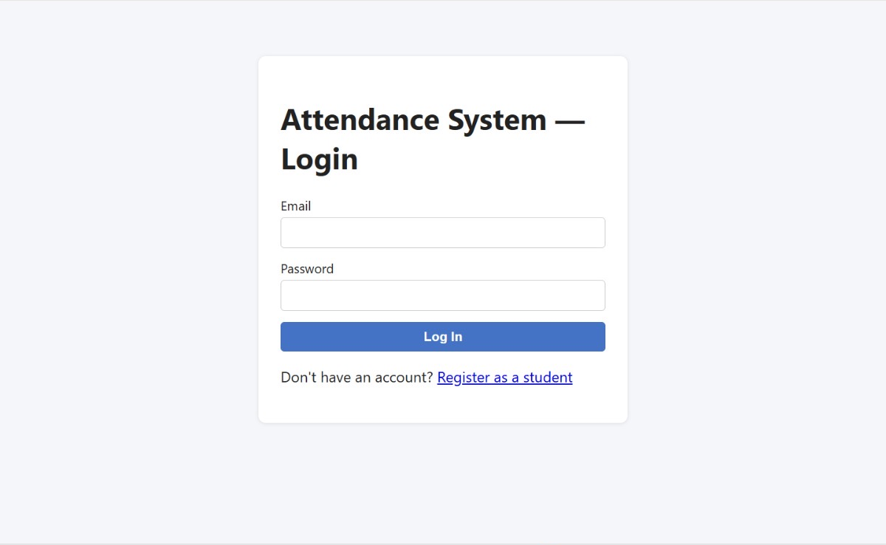
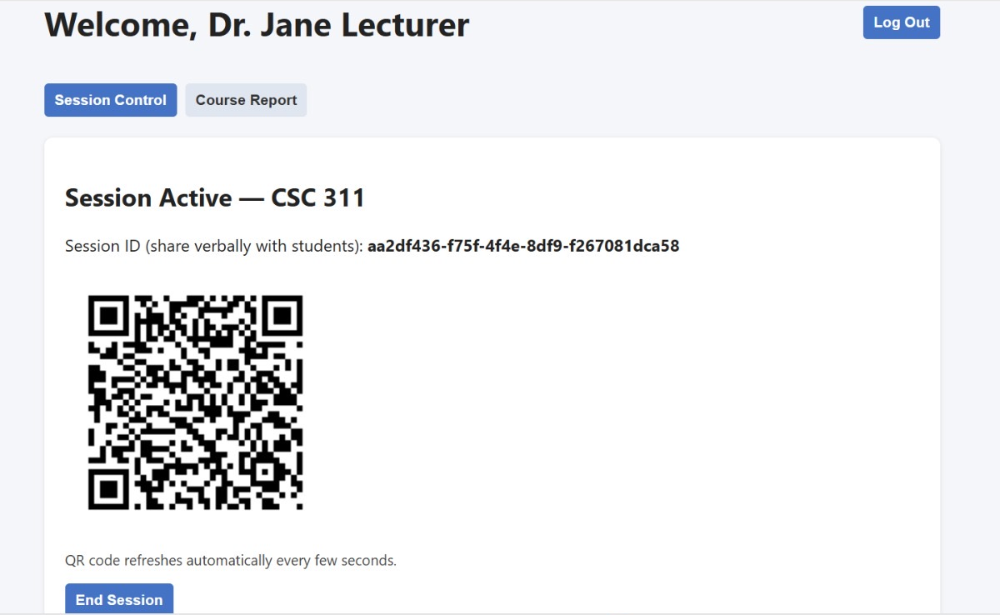
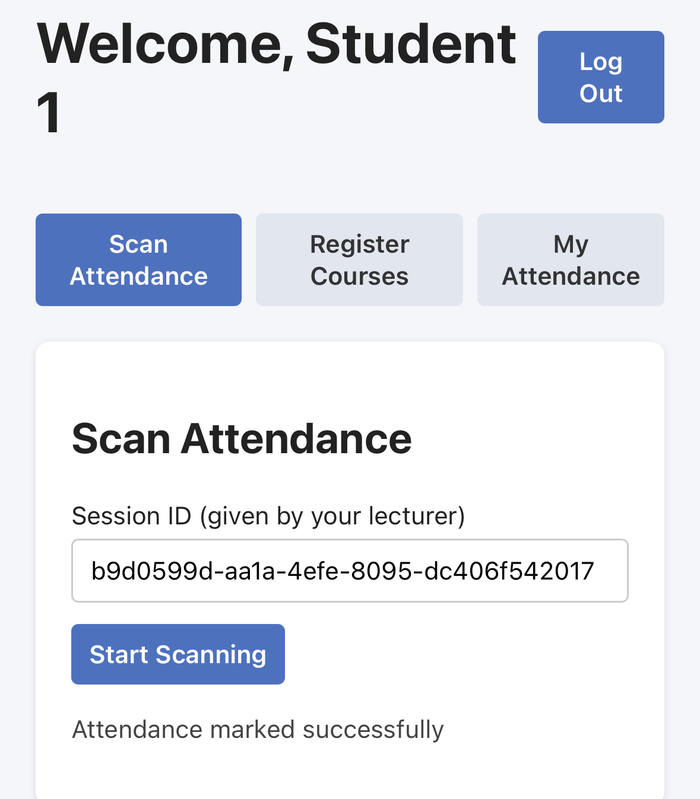
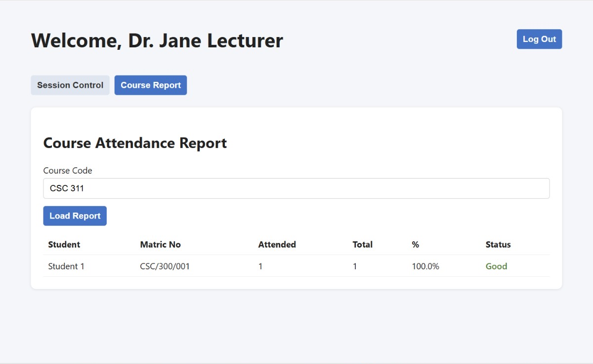
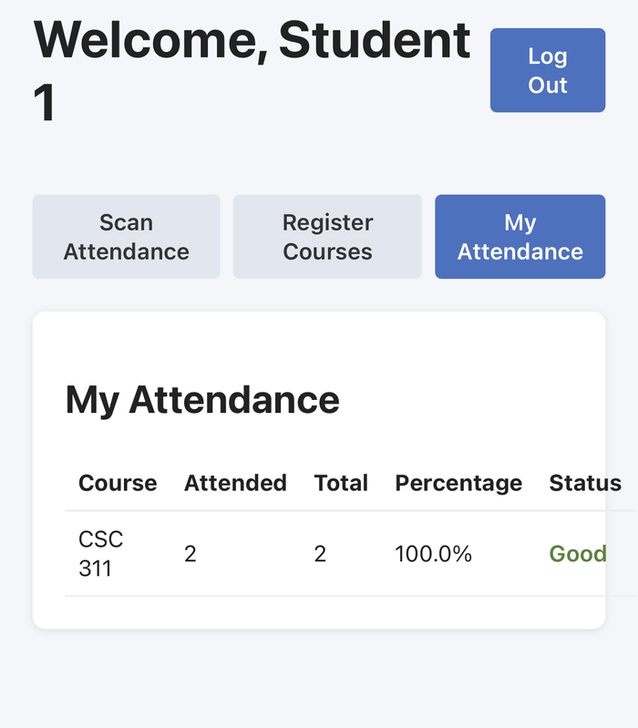

# Smart Class Attendance Management System

A full-stack web application that makes class attendance fast and hard to fake. Lecturers display a QR code that changes every 7 seconds; students scan it with their phones, and the server only records attendance if the student is **physically in the classroom** and **registered for the course**.

**Live demo:** https://smart-attendance-system-5cyu.onrender.com
*(hosted on a free plan, so the first load can take up to a minute while the server wakes up; demo logins are available on request)*

Built as my final year project for the B.Sc. in Computer Science at the University of Port Harcourt, adapting and extending the SmartEduTrack framework (Kurzadkar et al., 2026).

---

## The problem

In many Nigerian universities attendance is still taken with paper registers and roll calls. That wastes lecture time, the records are hard to analyse, and **proxy attendance** (signing in for an absent friend) is easy. Students often find out too late that they have fallen below the **75% attendance needed to write exams**.

## How it works

Every scan is checked on the server, in this order:

1. **Session:** the class exists and is still running
2. **QR token:** the code is current and genuine (it changes every 7 seconds and is signed with HMAC-SHA256, so screenshots expire and fakes are rejected)
3. **Geofence:** the student's GPS position is inside the classroom radius (Haversine formula)
4. **Registration:** the student is registered for that course this semester
5. **Duplicate:** the student has not already been marked present

A photo of the QR code sent to an absent friend fails twice: it has expired, and the friend is outside the geofence.

## Features

- **Three roles:** Student, Lecturer and Administrator
- **Dynamic QR codes** that refresh every 7 seconds
- **GPS geofencing** with an adjustable radius per class
- **Course registration** by department and level, including faculty-wide courses; a class cannot start if nobody is registered
- **Offline capture:** scans made without internet are saved on the phone, sent automatically when the connection returns, and verified by their signed token
- **Attendance analytics:** each registered student's percentage over completed classes, with an **At Risk** flag below 75%
- **Faculty dashboard** for administrators, filterable by department and level
- **Secure by default:** bcrypt password hashing, JWT logins that expire after 12 hours, and role checks enforced on the server

## Screenshots

| Login | Lecturer: live session | Student: scan accepted |
|---|---|---|
|  |  |  |

| Course report | Admin dashboard | Student: my attendance |
|---|---|---|
|  |  |  |

## Tech stack

| Layer | Technology |
|---|---|
| Frontend | React (Vite), html5-qrcode, qrcode, Dexie.js (IndexedDB), Axios |
| Backend | Node.js, Express |
| Database | MongoDB Atlas with Mongoose |
| Security | JWT, bcrypt, HMAC-SHA256 signed QR tokens |
| Hosting | Render (single web service serving the API and the React build) |

## Project structure

```
backend/    Express API: models, routes, middleware, services (QR tokens, analytics), seed script
frontend/   React app: student, lecturer and administrator screens
package.json  Root scripts used for deployment (build + start)
```

## Running it locally

Requirements: Node.js 18+ and a MongoDB database (MongoDB Atlas free tier works).

```bash
# Backend
cd backend
npm install
cp .env.example .env      # then fill in MONGO_URI, JWT_SECRET, QR_SECRET, DEMO_PASSWORD
npm run seed              # loads sample courses and demo accounts
npm run dev               # http://localhost:5000

# Frontend (in a second terminal)
cd frontend
npm install
npm run dev               # http://localhost:3000
```

Phones need HTTPS for the camera and GPS, so to test on a phone locally, expose port 3000 with a tunnel such as Cloudflare Tunnel.

## Deployment

Deployed on Render as one web service:

- Build command: `npm run build`
- Start command: `npm start`
- Environment variables: `MONGO_URI`, `JWT_SECRET`, `QR_SECRET`

## Testing

- Unit tests: 11/11 passed
- Integration tests: 6/6 passed
- System tests: 8 of 10 passed (2 not yet run)
- Live trials on a real iPhone over three days, which found and fixed three bugs: a percentage above 100%, empty "false start" sessions being counted as classes, and the server stopping when the internet dropped

## Limitations and future work

- Matric number format and duplicate checks
- Enforcing lecturer-to-course assignment
- Putting the Session ID inside the QR code, and a short grace period for slow networks
- Stored GPS coordinates for each lecture venue
- Integration with the university's student records

## Author

**Michael Edwin Panama** · Computer Science, University of Port Harcourt
GitHub: [@ediboy-dev](https://github.com/ediboy-dev)
